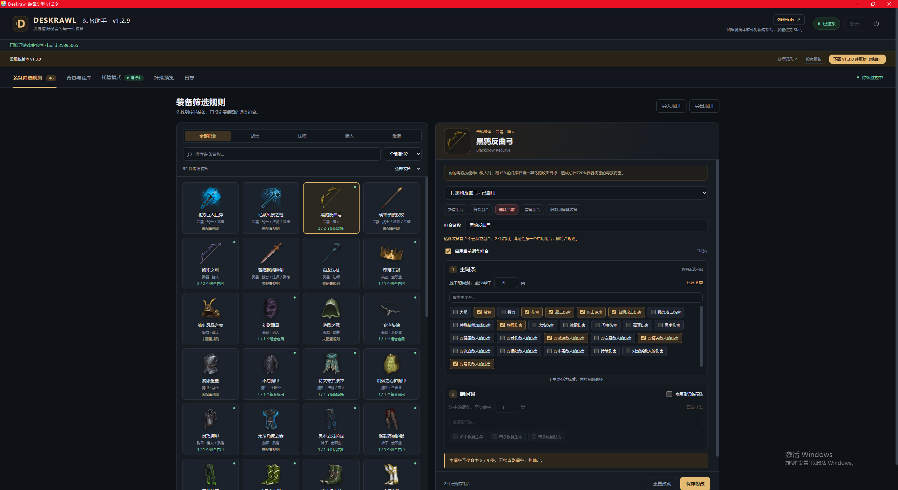
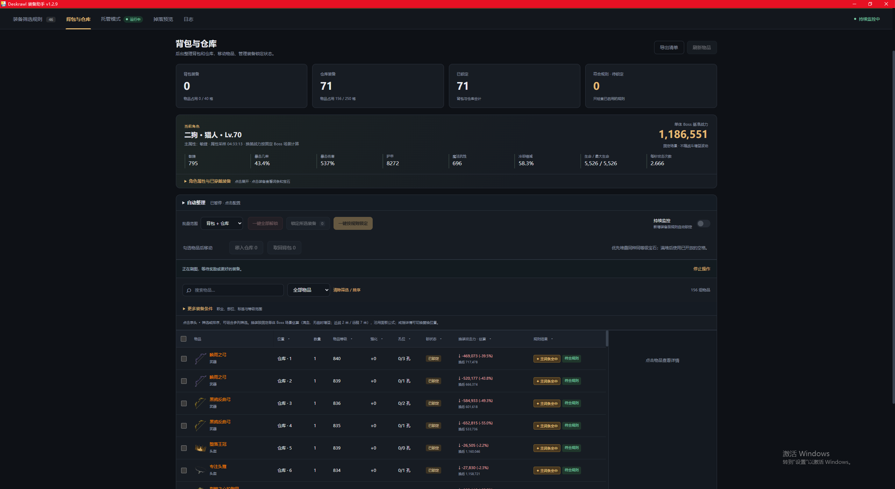
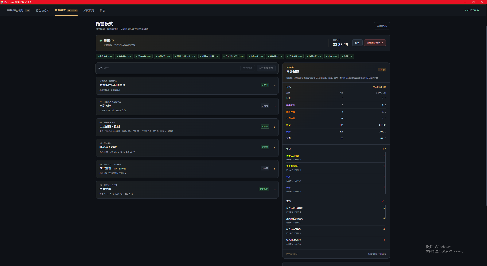
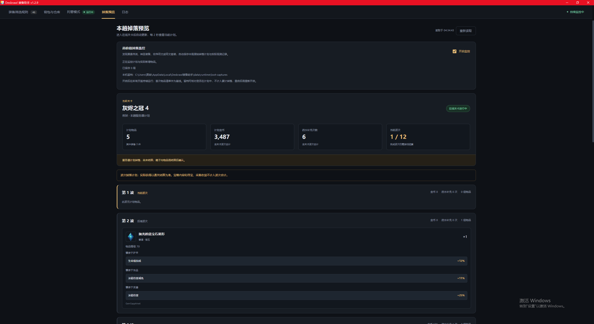

# Deskrawl 装备助手

为 Deskrawl 提供装备筛选、物品整理与自动刷图的 Windows x64 工具，无需安装 Python。当前版本：**v1.5.6**。

**[下载 Windows 版](https://github.com/awesomehy/Deskrawl-Assistant/releases/download/v1.5.6/Deskrawl-Assistant-v1.5.6.exe)** · [大陆下载](https://hhyan.me:25667/s/a1247f09c37c4b4bb7) · [官网](https://deskrawl.hhyan.me/) · [全部版本与更新说明](https://github.com/awesomehy/Deskrawl-Assistant/releases)

## 快速开始

1. 双击 exe，启动游戏并进入角色，在助手顶部点击“连接游戏”。
2. 配置并启用装备筛选规则，在“背包与仓库”检查命中结果。
3. 按需配置托管关卡、换装与回城整理策略，保存后手动启动。

已有版本可使用顶部“一键更新”，升级后保留配置。缺少 WebView2 时，安装[微软官方运行时](https://go.microsoft.com/fwlink/p/?LinkId=2124703)。

## 功能预览

截图取自[官网](https://deskrawl.hhyan.me/)，具体界面以当前版本为准。

### 装备筛选规则

为角色与仆从传说装备配置多套主／副词条组合和命中数量，支持规则复制、导入与导出。

### 背包与仓库

查看物品详情与换装战力预估，按品质、规则结果或可交易状态筛选；支持自动锁定、双向搬运、分区整理及主城批量上架。

### 托管模式

自动推图、双图轮刷、神话裂隙与南瓜王优先刷取，配合自动换装、回城整理和累计掉落统计。支持神秘商人消费、成长预设、宝石／符文合成、断线重连及交易所／Steam 市场上架。

### 掉落预览

查看在线关卡各波次的计划奖励、物品词条与规则命中，高价值掉落可保存原始计划和实际观测记录。

此外，“日志”可查询物品操作记录，“交流&反馈”提供 QQ 群入口。

## 兼容性与数据

- 已验证 **Deskrawl 1.1.0a / Steam build 26337088**；游戏更新后可能需要适配。
- 配置与日志保存在 `%LOCALAPPDATA%\Deskrawl装备助手\`，升级保留；Steam 登录凭证使用当前 Windows 用户的 DPAPI 在本机加密保存。
- 自动合成、交易所上传与 Steam 出售默认关闭，启用前请确认配置；战力和市场报价仅供参考，掉落以游戏实际结算为准。

[使用与数据说明](docs/使用与数据说明.md)包含收纳规则、合成与上架限制、旧配置迁移及异常恢复细节。

## 文档与反馈

[版本记录](docs/版本记录.md) · [掉落预览说明](docs/掉落预览说明.md) · [交易所与 Steam 市场](docs/拍卖行与Steam市场验收说明.md) · [源码运行与构建](docs/开发与构建.md) · [第三方资源说明](NOTICE.md)

欢迎提交 [Issue](https://github.com/awesomehy/Deskrawl-Assistant/issues) 或 [Pull Request](https://github.com/awesomehy/Deskrawl-Assistant/pulls)，也欢迎点亮 **Star** 支持项目。

## 许可证

本项目软件采用 [AGPL-3.0](LICENSE) 许可证。
