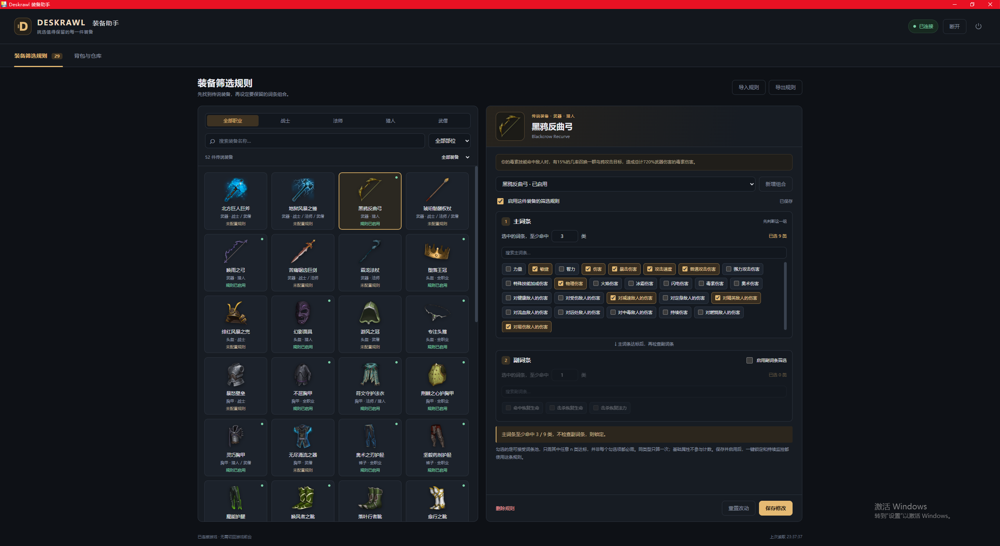
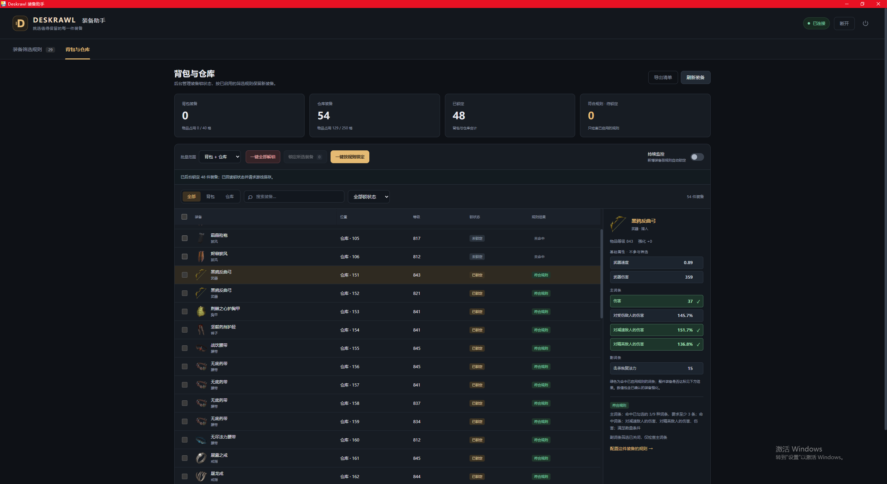

# Deskrawl 装备助手

为 Deskrawl 提供装备筛选、物品整理与自动刷图的 Windows x64 工具。使用独立窗体，无需安装 Python。当前版本：**v1.5.2**。

继续适配游戏 1.1.0。修复宝箱塞满背包后整理阻塞，宝箱累计 20 个回城并分批开启、整理和收取；仆从装备筛选规则接入背包筛选、自动锁定及托管整理，命中规则的仆从装备固定锁定入库。[本版说明](docs/1.5.2验收说明.md)。

如果觉得本软件对你有帮助，欢迎在 [GitHub 项目](https://github.com/awesomehy/Deskrawl-Assistant) 点亮 **Star**！

## 下载与使用

**[下载 v1.5.2 exe](https://github.com/awesomehy/Deskrawl-Assistant/releases/download/v1.5.2/Deskrawl-Assistant-v1.5.2.exe)** · [全部 Releases 与更新记录](https://github.com/awesomehy/Deskrawl-Assistant/releases)

1. 下载并双击 exe；启动游戏、进入角色，在助手顶部点击“连接游戏”。主城和战斗场景均可使用。
2. 在“装备筛选规则”中配置并启用规则，到“背包与仓库”检查结果，按需开启持续监控和自动整理。
3. 需要自动刷图时，在“托管模式”配置关卡、换装和奖励处理策略，保存后手动启动。

缺少 WebView2 时，请安装[微软官方运行时](https://go.microsoft.com/fwlink/p/?LinkId=2124703)。已有版本可通过顶部“一键更新”升级；手动升级请先保存设置并退出旧版。v1.1.5 / v1.1.6 用户首次升级需手动下载最新版。

**v1.4.6 / v1.5.0 / v1.5.1 可直接升级到 v1.5.2，无需安装中间版本。** 原有筛选规则、托管预设、整理分区、合成配置及有效 Steam 登录凭证继续保留。旧版南瓜王刷图配置迁移为独立开关和难度，原常规关卡轮换配置保留；仆从装备原处理方式分别沿用到普通传说和稀有，保留原存放页。更早版本没有仆从装备配置时，默认入库并沿用原装备存放页，不自动增加上架或出售权限。

## 核心功能

| 页面 | 可以做什么 |
| --- | --- |
| 装备筛选规则 | 按职业、部位选择传说装备，配置多套主／副词条组合；至少命中指定数量即保留，支持导入、导出和复制规则。 |
| 背包与仓库 | 查看角色属性、穿戴装备、词条及宝石，单独筛选和查看仆从装备；显示换装战力预估，支持可交易筛选、Steam 市场参考价、自动锁定、双向搬运与分区整理；主城可将选中商品批量上传交易所，并选择同时上架 Steam 市场。 |
| 托管模式 | 自动换装、推图或双图轮刷、南瓜王优先刷取、回城整理与掉落统计；支持神话裂隙、仆从装备按筛选规则与品质处置、碎片消费、成长预设、宝石／符文自动合成、断线重连，以及按类别上传交易所并出售到 Steam 市场。[上架说明](docs/拍卖行与Steam市场验收说明.md) |
| 掉落预览 | 进入在线关卡后查看各波次计划物品、效果和分组词条，命中高亮；支持高价值掉落原始数据留档。[使用说明](docs/掉落预览说明.md) |
| 日志 | 查看新增物品、锁定、搬运及操作记录，支持搜索与历史查询。 |
| 交流&反馈 | 查看QQ群二维码和群号，交流游戏心得与反馈使用问题。 |

## 使用截图

**装备筛选规则**：选择装备，设置可接受的词条与命中数量。

**背包与仓库**：查看数值和命中高亮，管理装备与物品。

## 兼容性与数据

已验证基准为 **Deskrawl 1.1.0 / Steam build 26310087**。更新背包、仓库、马车、角色、关卡、掉落预览、成长、商人、合成、交易所及重连接口。支持普通名称、序号与地址变化的自动检测适配；新增资源、结构或逻辑变化需要维护。掉落预览与托管原生动作有独立构建校验，未适配时停用。

托管固定保留神圣、黑雾装备，并将所有符文、宝石、金条和传说缰绳强制收纳；神圣装备不自动穿戴。每类收纳至少选一个已解锁仓库页，满仓时保留在背包并暂停等待。先完成整批筛选锁定，再处理垃圾，主城奖励未清空时不入图。新用户默认装备存放第 1／2／3 页、符文第 4 页，宝石、金条和传说缰绳第 5 页，仅使用已解锁格位。

角色装备与仆从装备分别按已启用的筛选规则判断，命中装备固定锁定入库，各自使用对应的存放页。仆从装备的黑雾传说也固定锁定入库，未命中的普通传说和稀有可分别选择入库、出售或分解；已锁定或待核验装备继续保护。背包与仓库支持仆从装备命中筛选、词条高亮、自动锁定和持续监控。旧版未命中处置与存放页保留，开发版可编辑的命中处置自动改为固定保护。累计掉落单独展示仆从装备，交易所／Steam 出售的“仆从装备（可交易）”类别默认不勾选；原有黑雾装备类别不会自动覆盖仆从装备，具体商品的强制保留名单仍优先。仆从装备不参与角色自动换装，本版不提供仆从自动培养。

南瓜王使用独立的“优先刷南瓜王”开关，新用户默认关闭；可选择普通、噩梦、炼狱或沿用启动时当前难度，界面显示每日共享剩余入场次数。开启后优先刷取，次数耗尽、活动结束或尚未解锁时，继续原有自动推图或重复刷图配置；未开启原副本刷图时等待每日重置或活动开放。南瓜王从普通轮刷关卡列表移除，成功次数单独记录，不占用原副本轮换配额；已进入的当前局先完成奖励收取和整理。普通、噩梦、炼狱南瓜王宝箱继续支持回城自动开启，锁定宝箱不自动开启。

背包宝箱总数量达到 20 个时触发回城；主城整理时优先开启这一批宝箱并按规则处理装备，再继续收取马车和地面物品。收取后再次达到 20 个就重复分批整理；满包但未到 20 个时也可先开箱腾位。锁定或待核验宝箱不会自动开启，药水等保留物品继续占用原背包格位。

观星刷本入口暂时隐藏，旧配置中的开启状态自动关闭，不再因奖励筛选跳过副本；原奖励勾选继续保留。掉落预览和高价值掉落监控仍可正常使用。

宝石、符文自动合成正式开放，新旧用户默认关闭；分别设置最高产出品质，符文可指定跳过种类。仅在主城整理时合成，锁定、装备中和跳过的材料不参与；符文概率合成失败也会消耗材料，已有等级与经验不保留。Steam 换算报价标为参考价，实际交易以 Steam 为准。

交易所上传和 Steam 市场出售默认关闭，允许类别默认全不选；可按具体商品设置强制保留。Steam 出售须先开启交易所上传，并登录与游戏一致的 Steam 账号；价格可选最低在售价或最高求购价，均为买方含手续费总价，使用实际 Steam 钱包币种。托管在主城整理时执行；手动批量上传仅在已确认主城、托管和其他物品操作未运行时可用。上传忽略锁定状态，但不处理穿戴、绑定、强化、有孔或身份不完整的物品；无独立实例编号的堆叠材料暂不上传。只出售本工具本次已确认上传且准确匹配的 Steam 新增资产，不接管原有 Steam 库存；需要手机或邮件确认时由用户在 Steam 中完成，挂牌不等于成交。

Steam 登录凭证以当前 Windows 用户的 DPAPI 加密保存在本机，同一 Windows 用户升级后继续读取并重新核验；凭证失效时需重新登录。早期开发版已删除的上架字段继续兼容迁移。回退旧版前请备份配置；旧版不识别新增仆从装备设置时，应恢复对应旧版配置备份。

换装战力按固定单体 Boss 场景估算，不能完整模拟暗金特效与实际 DPS。掉落预览是尚未结算的计划，实际获得以游戏为准；宝箱内部和额外收益不提前推测。

断线自动重连默认关闭，在托管状态中配置在线角色列表序号并保存后启用。仅托管运行时响应掉线，临时连接失败会间隔重试；角色不符或长时间未恢复时暂停并保留统计。

规则、设置和日志保存在 `%LOCALAPPDATA%\Deskrawl装备助手\`，更新后保留；新启动不会自动连接或开启监控、整理、托管。顶部显示游戏运行状态，可通过 Steam 启动游戏，关闭游戏需二次确认。图标与必要资源全部内置，个人数据不随程序分发。

## 开发与更新记录

[版本记录](docs/版本记录.md) · [1.5.2 验收说明](docs/1.5.2验收说明.md) · [游戏 1.1.0 适配](docs/游戏1.1.0兼容性验证.md) · [源码运行与构建](docs/开发与构建.md) · [第三方资源说明](NOTICE.md)

## 贡献

欢迎通过提 [Issue](https://github.com/awesomehy/Deskrawl-Assistant/issues) 或 [Pull Request](https://github.com/awesomehy/Deskrawl-Assistant/pulls) 的方式贡献代码、报告 Bug 或提出建议。

## 许可证

本项目软件采用 [AGPL-3.0](LICENSE) 许可证。
